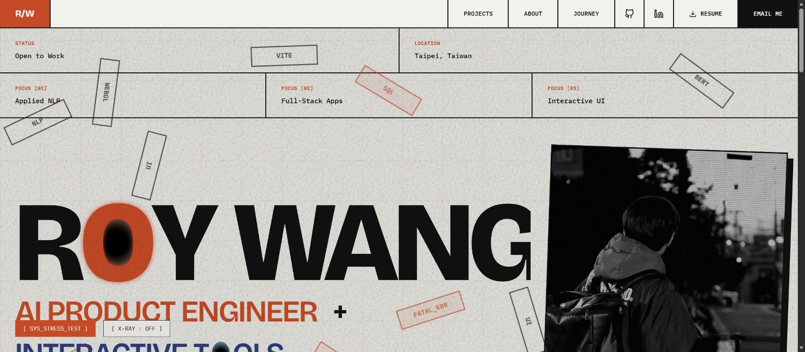

# Phase 1 historical delivery and verification

This is the phase-1 snapshot. The current subscription-based architecture, verification and remaining setup are documented in PHASE2_DELIVERY.md, LOCAL_AGENTS.md and SECURITY.md. The former optional model API setup below is historical and has been removed.

Verified on 2026-10-19. The public source, Profile consumer and existing Astro site are deployed. AI-authored discovery is implemented but requires a provider credential; the tested discovery run used explicitly labelled evidence-only mode.

## Live deliverables

| Deliverable | Link | State |
| --- | --- | --- |
| Canonical public facts and agent contract | https://github.com/RoyWG925/builder-context | Live |
| Shared agent context | https://roywg925.github.io/portfolio-astro/ai-context.md | HTTP 200 |
| Existing Astro portfolio | https://roywg925.github.io/portfolio-astro/ | Live; original interaction script and global CSS preserved |
| Project evidence and hackathon journey | https://roywg925.github.io/portfolio-astro/identity/ | HTTP 200; evidence panels tested |
| GitHub Profile | https://github.com/RoyWG925 | Generated README synchronized |
| Generated one-page resume | https://roywg925.github.io/portfolio-astro/Roy_Wang_Resume.pdf | HTTP 200; rendered and visually checked |
| HTML resume | https://roywg925.github.io/portfolio-astro/resume.html | HTTP 200 |
| Public JSON | https://roywg925.github.io/portfolio-astro/identity.json | HTTP 200; matches source revision |
| LinkedIn drafts | https://github.com/RoyWG925/builder-context/blob/main/generated/linkedin.md | Generated; manual publishing only |
| First scheduled-discovery proposal | https://github.com/RoyWG925/builder-context/pull/1 | Open for Roy; no facts auto-approved |

The separate private intake repository contains seven private-repository evidence entries and professional source reconciliation. Its contents and source conversation are not inputs to any public job. Two private repositories did not expose a README at the inspected root path and are explicitly recorded as metadata-only.

## Checks completed

- **21 automated tests passed**, covering deterministic generation, source hashes, private and unknown-field rejection, missing evidence, HTML escaping, competition outcome restrictions, attribution controls, owner-only confirmation and actual candidate promotion with test fixtures.
- **Source CI passed:** https://github.com/RoyWG925/builder-context/actions/runs/39223453009
- **Discovery ran and opened PR #1:** https://github.com/RoyWG925/builder-context/actions/runs/39217658469
- **PR CI passed after the first-run workflow execution was approved:** https://github.com/RoyWG925/builder-context/actions/runs/39217689639
- **Production build, PDF generation, route checks and Pages deployment passed:** https://github.com/RoyWG925/portfolio-astro/actions/runs/39223643479
- **Profile sync passed:** https://github.com/RoyWG925/RoyWG925/actions/runs/39223768966
- Homepage, journey, JSON, agent context, HTML resume and PDF were checked online. The X-ray control toggled on and off; the stress test ran; the original homepage interaction script was compared byte-for-byte with the pre-integration source and was unchanged.
- The generated PDF is one A4 page; all four featured projects are present. Rendering was inspected for clipping, spacing and legibility.
- Public source, deployed JSON and Profile README all used revision `61890423f0846e3fa41cdd735ca8c7611364d5fffaad33af64a52e4b2f8468ab` at final verification.

The first deployment attempt had an incorrect deploy-pages action SHA. It was corrected against the official action repository; subsequent production runs succeeded.

## Normal operation

1. Daily at **09:17 Asia/Taipei**, discovery checks public repository evidence and opens a candidate PR when source commits change. An open discovery PR is preserved until reviewed.
2. Roy reviews and personally merges a candidate PR. Agents are explicitly prohibited from merging fact proposals, even when authenticated as Roy. The promotion workflow records the merger, PR and exact merge commit and generates public outputs.
3. Profile pulls the canonical output hourly at minute 35. Astro pulls one immutable source commit, renders the PDF, builds and deploys hourly at minute 45. Manual runs are available. GitHub can delay scheduled runs; synchronization is eventual.
4. LinkedIn remains a draft; Roy pastes and publishes manually. Application material is also draft-only.

## Remaining manual work

- Configure Actions secret **IDENTITY_AI_API_KEY** at https://github.com/RoyWG925/builder-context/settings/secrets/actions. Optional variables are **IDENTITY_AI_BASE_URL** and **IDENTITY_AI_MODEL**. The adapter uses an OpenAI-compatible Chat Completions endpoint. No live model call was claimed or tested without this credential.
- Review **PR #1** and correct any facts before personally merging it. Public competition submission, awards and VIRAL's exact individual/team contribution remain unconfirmed; current public repository association is recorded without inventing those outcomes.
- Publish the LinkedIn wording manually after review.

GitHub Models was retired in July 2026, so the implementation does not depend on that retired API. Current provider availability and credentials are an explicit prerequisite for AI-authored suggestions. Evidence collection, PR creation, confirmation, rendering, Profile synchronization and deployment work without that secret.

The original local resume folder and the original local Astro checkout were not overwritten. Implementation was prepared in an isolated working copy and published to the repositories above.

